<p align="center">
  
</p>

<p align="center">
  <a href="https://www.linkedin.com/in/-arindam-bhattacharyya/"></a>
  <a href="https://leetcode.com/u/ArindamBhatta/"></a>
  <a href="mailto:arindambhattacharyya.ab@gmail.com"></a>
  
</p>

---

### `$ who am i`

```dart
class Arindam extends Engineer {
  final role       = 'Full-Stack Flutter Developer';
  final experience = '2.5+ years in production';
  final platforms  = ['Android', 'iOS', 'Windows', 'Web'];
  final strengths  = ['Clean Architecture', 'Offline-first', 'Realtime backends', '60 fps UI'];
  final backend    = 'Laravel + Reverb (WebSockets)';   // current
  final funFact    = 'Civil engineer → software engineer 🏗️ → 📱';
}
```

---

### ⚡ Tech Stack

<p align="center">
  <br />
  <br />
  
</p>

<table>
  <tr>
    <td width="50%" valign="top">

#### 📱 Mobile
Flutter · Bloc/Cubit · Clean Architecture · GoRouter · Firebase (Firestore, Functions, Auth, FCM) · SQLite (FTS5) · Isolates · Dio · just_audio

</td>
    <td width="50%" valign="top">

#### 🛠️ Web & Backend
PHP · TypeScript · WebSockets · Laravel · Express · Supabase · PostgreSQL · Cloud Scheduler · WhatsApp Cloud API

</td>
  </tr>
</table>

---

<p align="center">
  
</p>
